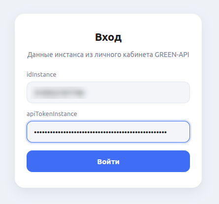
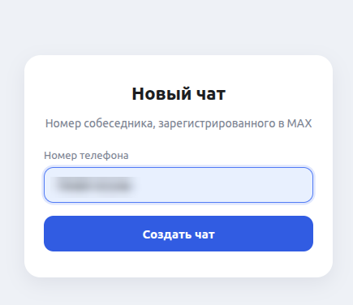
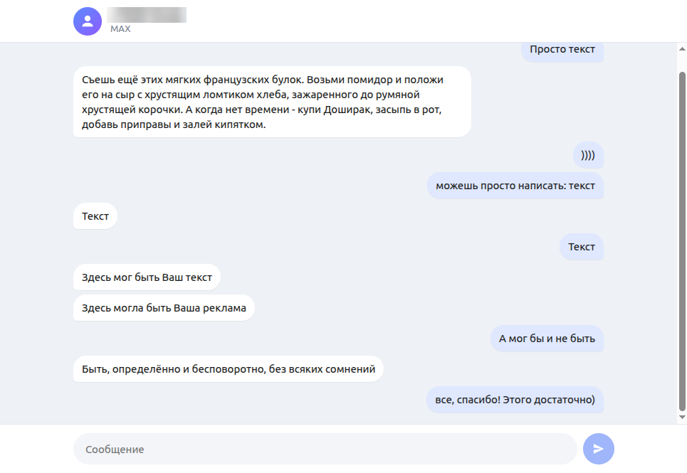

# Чат для MAX на GREEN-API

Простой веб-чат для отправки и получения текстовых сообщений в мессенджере MAX через [GREEN-API](https://green-api.com/max). Интерфейс сделан по мотивам [web.max.ru](https://web.max.ru/).

**Демо:** https://test-green-api-green.vercel.app/

## Возможности

- вход по `idInstance` и `apiTokenInstance` с проверкой состояния инстанса (`getStateInstance`);
- создание чата по номеру телефона с проверкой, что номер зарегистрирован в MAX (`checkAccount`);
- отправка текстовых сообщений (`sendMessage`);
- получение входящих через HTTP API: опрос `receiveNotification` (long polling) с удалением каждого уведомления через `deleteNotification`;
- обработка ошибок сети и API, светлая и тёмная тема.

## Стек

React 19, TypeScript, Vite, CSS Modules. Без сторонних библиотек: запросы к API — через `fetch`.

## Перед запуском

В настройках инстанса GREEN-API (личный кабинет → инстанс → «Изменить» или метод setSettings):

- включите «Получать уведомления о входящих сообщениях и файлах» (`incomingWebhook: "yes"`);
- оставьте пустым «Адрес отправки уведомлений» (`webhookUrl: ""`) — входящие забираются через HTTP API (receiveNotification / deleteNotification).

Настройки применяются в течение ~5 минут.

## Локальный запуск

Нужен Node.js 20.19+ или 22.12+.

```bash
git clone https://github.com/BalandinaM/test-green-api.git
cd test-green-api
npm install
npm run dev
```

Приложение откроется на http://localhost:5173.

Сборка для продакшена:

```bash
npm run build
npm run preview
```

## Как пользоваться

1. Введите `idInstance` и `apiTokenInstance` из личного кабинета GREEN-API. Данные не сохраняются и никуда, кроме API GREEN-API, не отправляются.
2. Введите номер собеседника в формате `7XXXXXXXXXX` и нажмите «Создать чат».
3. Пишите сообщения — они уходят собеседнику в MAX. Его ответы появятся в чате автоматически.

## Ограничения

- только текстовые сообщения;
- история чата не загружается. Входящие, пришедшие, пока приложение было закрыто, подтянутся из очереди уведомлений GREEN-API (она хранит их до 24 часов);
- один чат за сессию.

## Скриншоты

| Вход | Новый чат |
| --- | --- |
|  |  |

Переписка:


